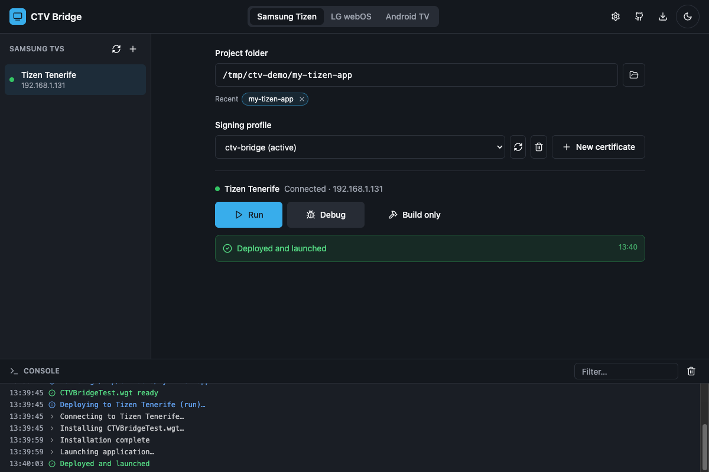

# CTV Bridge


**Build, install and debug your web app on real Samsung Tizen, LG webOS and Android TVs in one click.**

CTV Bridge is a free, open-source desktop app on top of the official vendor tools (`sdb`/`tizen`, `ares-*`, `adb`). It replaces the repetitive CLI commands with a single screen, and everything runs locally on your machine.

<p align="center">
  
</p>

## ✨ Features

- **One screen**: your TVs on the left, your project and actions on the right, a live console at the bottom.
- **Run**: builds the `.wgt` / `.ipk`, installs it (replacing the old version) and launches it.
- **Debug**: the same, then opens DevTools for your app in its own window. On Android this works for apps with a debuggable WebView.
- **Remembers everything**: TVs, recent projects and signing profiles, per platform.
- **Connection status at a glance**: select a TV and its dot turns green or red, with the reason.
- **webOS SSH keys** set up automatically from the Developer Mode passphrase.
- **Tizen certificates**: sign in with Samsung and create a signing profile from inside the app, with your TVs' DUIDs pre-filled.
- **Automatic updates** on macOS, Windows and Linux.

## 🚀 Quick start

### 1. Install your TV's SDK

| Platform          | SDK                                                                                 | Enable on the TV                                                      |
| ----------------- | ----------------------------------------------------------------------------------- | --------------------------------------------------------------------- |
| Samsung           | [Tizen Studio](https://developer.tizen.org/development/tizen-studio/download)       | Apps → press `1 2 3 4 5` → Developer Mode on, with your computer's IP |
| LG                | [webOS TV CLI](https://webostv.developer.lge.com/develop/tools/cli-installation)    | Install the **Developer Mode** app, turn on Dev Mode and Key Server   |
| Android / Fire TV | [Platform Tools (adb)](https://developer.android.com/tools/releases/platform-tools) | Developer options → USB / Network debugging                           |

The tools don't need to be on your PATH; you can point CTV Bridge to them.

### 2. Install CTV Bridge

[**⬇️ Download the latest release**](https://github.com/Braggiouy/ctv-bridge/releases/latest)

- **macOS** (Apple Silicon): `.dmg`
- **Windows**: `-setup.exe`
- **Linux**: `.AppImage`

<details>
<summary>🍎 macOS says the app "is damaged and can't be opened"</summary>

The app isn't notarized by Apple (that requires a paid developer account). Move it to Applications, then run:

```bash
xattr -cr /Applications/CTV\ Bridge.app
```

</details>

<details>
<summary>🪟 Windows shows "Windows protected your PC"</summary>

This is SmartScreen's normal warning for unsigned open-source apps. Click **More info** → **Run anyway**.

</details>

<details>
<summary>🐧 Linux: make the AppImage executable</summary>

```bash
chmod +x ctv-bridge-*.AppImage
./ctv-bridge-*.AppImage
```

</details>

### 3. Deploy your first app

1. **Pick your platform** at the top and click **Check tools**.
2. **Add your TV** with the **+** button:
   - _Samsung / Android_: the TV's IP address.
   - _LG_: a name, the IP, port `9922`, user `prisoner` and the passphrase shown in the Developer Mode app.
3. **Select the TV**. A green dot means it's reachable.
4. **Choose your project**: the folder with `config.xml` (Tizen) or `appinfo.json` (webOS), or a built `.apk` (Android). Samsung TVs also need a signing profile: create one with **New certificate**.
5. Click **Run** or **Debug**.

<p align="center">
  
  
</p>

Change SDK paths any time from the ⚙️ button in the header.

## 🔄 Updates

CTV Bridge checks for new versions on startup and every few hours, and lets you know with a small notice.

- **Windows / Linux**: the update downloads in the background. Click **Restart**, or it installs the next time you quit.
- **macOS**: click **Update**, then **Restart**. If the app can't replace itself (for example when it runs from the DMG), the installer opens instead.

## 🔍 Troubleshooting

The selected TV shows its error next to its name, and the console at the bottom has the full SDK output.

<details>
<summary><b>"Some tools could not be found"</b></summary>

Open setup (⚙️), enter the full path to each tool and click **Check tools**. For example:

- Tizen: `~/tizen-studio/tools/sdb` and `~/tizen-studio/tools/ide/bin/tizen`
- webOS: `~/webOS_TV_SDK/CLI/bin/ares`
- Android: `~/Library/Android/sdk/platform-tools/adb`

</details>

<details>
<summary><b>The TV doesn't connect</b></summary>

- **macOS, `EHOSTUNREACH`**: allow CTV Bridge in System Settings → Privacy & Security → Local Network.
- **Samsung**: Developer Mode must be on and set to this computer's IP; TV and computer on the same network. Try `sdb connect <TV_IP>`.
- **LG**: keep the Developer Mode app open with Dev Mode and Key Server on; check the passphrase (✏️ next to the TV) and that port 9922 isn't blocked. Try `ares-device -i -d <TV_NAME>`.
- **Android**: enable USB/Network debugging and accept the prompt on the TV. Try `adb connect <TV_IP>`.

</details>

<details>
<summary><b>Build or install fails</b></summary>

- The project folder must contain `config.xml` (Tizen) or `appinfo.json` (webOS).
- Samsung apps must be signed with a profile whose certificate includes the TV's DUID.
- Author certificate mismatch (`install failed[118, -11]`) is handled automatically: CTV Bridge uninstalls the old app and retries.
- Check the TV has enough free storage.

</details>

<details>
<summary><b>macOS: "CTV Bridge needs to be updated" / won't open in a future macOS</b></summary>

This comes from Samsung's `sdb`, which is still Intel-only and runs through Rosetta; macOS attributes it to CTV Bridge because the app starts it. CTV Bridge itself is native Apple Silicon. The warning goes away once Samsung ships a native `sdb` (update Tizen Studio from its Package Manager).

</details>

## ❓ FAQ

**Which TVs are supported?**
Any Samsung Tizen TV, LG webOS TV or Android TV device (including Google TV and Fire TV) with developer/debug mode enabled.

**Can I deploy to several TVs at once?**
Not yet; CTV Bridge deploys to one TV at a time.

**Is it free?**
Yes, completely free and open source (MIT). Publishing to the Samsung/LG stores may need their developer accounts.

**Is my data safe?**
Everything stays on your machine. webOS passphrases and SSH keys are kept by the webOS CLI itself, exactly as when you use it from a terminal.

**Can I use it for production releases?**
It's built for development and testing. Publish through Samsung Seller Office or LG Seller Lounge.

## 👨‍💻 Development

[Bun](https://bun.sh) is used for development, CI and releases.

```bash
bun install      # install dependencies
bun run dev      # run the app in development mode
bun run build    # build installers for your OS
```

Contributions are welcome. See the [Contributing Guide](CONTRIBUTING.md) and use [Conventional Commits](https://www.conventionalcommits.org/).

## ⭐ Support the project

- **⭐ Star the repository** so other developers find it
- **🐛 [Report bugs or suggest features](https://github.com/Braggiouy/ctv-bridge/issues)**
- **💬 [Join the discussions](https://github.com/Braggiouy/ctv-bridge/discussions)**
- **☕ [Buy me a coffee](https://ko-fi.com/braggio)** if it saves you time

See also the [Security Policy](SECURITY.md) and [Code of Conduct](CODE_OF_CONDUCT.md).

## 📄 License

[MIT](LICENSE). CTV Bridge will always be free and open source.
