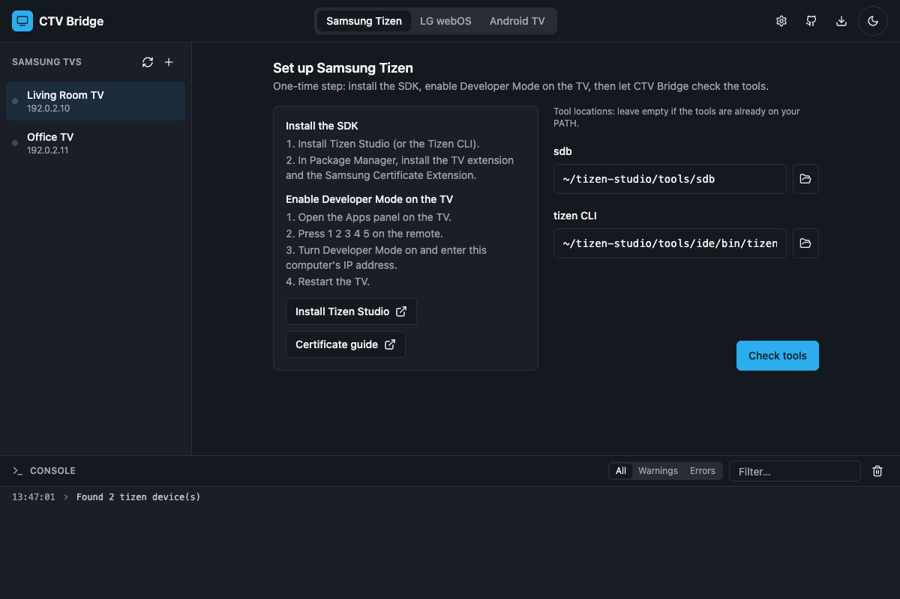
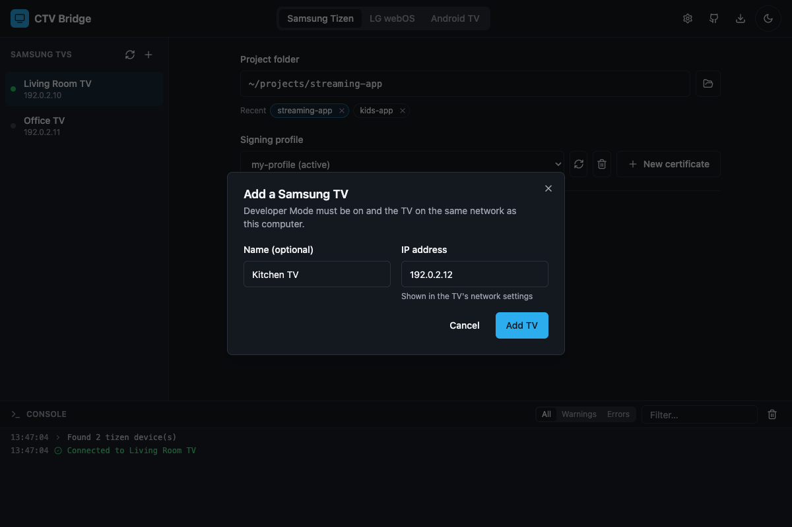
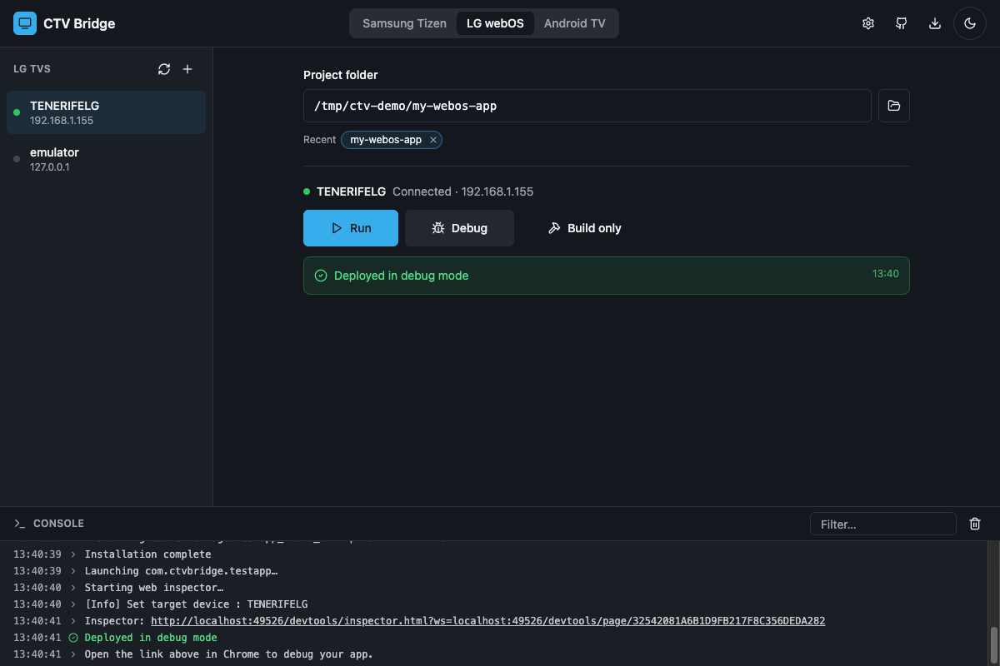

# CTV Bridge


**CTV Bridge is an open-source desktop tool that simplifies deploying and debugging Connected TV applications directly on real Samsung Tizen, LG webOS, and Android TV devices.**

## Why CTV Bridge exists

Developing for Connected TVs often means dealing with fragmented tooling, repetitive CLI commands,
and fragile deployment workflows that slow down iteration and testing.

CTV Bridge was created to reduce that friction by providing a single, unified interface on top of
the official Tizen, webOS, and Android tooling, without reinventing or replacing vendor SDKs.

---

## High-level architecture

CTV Bridge acts as a thin UI layer on top of official vendor CLIs (Tizen, webOS, Android),
handling command orchestration, device management and log aggregation,
while keeping all execution local to the developer machine.

---

## 🚀 Key Features

### 📺 Multi-Platform Support

- **Samsung Tizen**: Built on the Tizen Studio CLI (`sdb`, `tizen`).
- **LG webOS**: Built on the webOS TV CLI (`ares-*` tools).
- **Android TV**: Built on Android Debug Bridge (`adb`) for APK deployment on Android TV / Google TV / Fire TV.

### ⚡ One Screen, One Click

- **Workspace layout**: Your TVs on the left, your project and actions on the right, live console at the bottom. Everything fits in one window.
- **Run**: Builds the `.wgt` / `.ipk` package, installs it (replacing the old version) and launches it.
- **Debug**: Same as Run, with the web inspector attached and its URL shown in the console (Android: attach the Android Studio debugger).
- **Build only**: Just create the package.
- **Remembers your work**: TVs, recent projects and signing profiles are kept per platform.

### 🔌 Device Management

- **Add a TV once**: CTV Bridge remembers it and checks the connection when you select it (green / red status dot).
- **webOS SSH keys**: Set up automatically from the passphrase shown in the Developer Mode app.

### 🔐 Tizen Certificates

- **Samsung sign-in**: Sign in with your Samsung account in the browser, right from the app.
- **Certificate generator**: Creates `author.p12` and `distributor.p12` and registers them as a signing profile.
- **DUIDs pre-filled** from the Samsung TVs you've connected to.
- **Profile management**: Select, reload and delete Tizen security profiles.

---

## Who is this for?

CTV Bridge is designed for:

- CTV / Smart TV developers
- Frontend engineers working with Tizen, webOS, or Android TV
- QA engineers testing apps on real TV devices
- Teams building OTT / streaming applications

---

## 📸 Visual Walkthrough

### 1. One-time setup

Pick your platform, follow the short guide and click **Check tools**. SDK paths are optional when the tools are on your PATH.

<p align="center">
  
</p>

### 2. Add your TV

<p align="center">
  
</p>

### 3. Run and debug

Select the TV, choose your project and click **Run** or **Debug**.

<p align="center">
  
  
</p>

---

## 🚀 Getting Started

1. **Download** the latest release from the [GitHub releases page](https://github.com/Braggiouy/ctv-bridge/releases/latest) and install it (see below).
2. **Pick your platform** at the top and click **Check tools**.
3. **Add a TV** with the **+** button:
   - _Tizen_: the TV's IP address (Developer Mode must point to this computer's IP).
   - _webOS_: name, IP, port `9922`, user `prisoner` and the passphrase from the Developer Mode app.
   - _Android_: the TV's IP address (enable network debugging on the TV).
4. **Select the TV**. The dot turns green when it's reachable; otherwise the error appears next to its name.
5. **Choose your project** (Tizen: folder with `config.xml`, webOS: folder with `appinfo.json`, Android: a built `.apk`). Tizen also needs a signing profile; create one with **New certificate**.
6. Click **Run** or **Debug**. Output appears in the console.

You can change SDK paths later from the ⚙️ button in the header.

---

## 📥 Installation

Download the latest release for your operating system:

- **macOS** (Apple Silicon): `.dmg`
- **Windows**: `-setup.exe` installer
- **Linux**: `.AppImage`

[**Download Latest Release**](https://github.com/Braggiouy/ctv-bridge/releases/latest)

### 🍎 macOS Installation Note

If you see a message saying **"CTV Bridge is damaged and can't be opened"**, this is because the app is not notarized by Apple (which requires a paid developer account).

To fix this, open your Terminal and run:

```bash
xattr -cr /Applications/CTV\ Bridge.app
```

_(Make sure you've moved the app to your Applications folder first)_

### 🪟 Windows Installation Note

You may see a **"Windows protected your PC"** (SmartScreen) popup. This is normal for unsigned open-source apps.

1. Click **"More info"**
2. Click **"Run anyway"**

### 🐧 Linux Installation Note

If you are using the `.AppImage` file, you must make it executable before running it:

```bash
chmod +x ctv-bridge-*.AppImage
./ctv-bridge-*.AppImage
```

---

## 🔧 Prerequisites

To use CTV Bridge, you'll need to download and install the respective SDKs:

- **Samsung Tizen**: [Tizen Studio](https://developer.tizen.org/development/tizen-studio/download)
- **LG webOS**: [webOS TV CLI](https://webostv.developer.lge.com/develop/tools/cli-installation)
- **Android TV**: [Android Platform Tools (ADB)](https://developer.android.com/tools/releases/platform-tools)

> **Note**: You don't need to add SDK tools to your system PATH. CTV Bridge lets you set the full path to each tool in the setup screen (e.g., `/path/to/tizen-studio/tools/sdb`).

---

## 🔍 Troubleshooting

### SDK Not Detected

**Problem**: "Some tools could not be found" or command errors when deploying.

**Solution**: open setup (⚙️ in the header), enter the **full path** to each tool and click **Check tools**. Each tool shows whether it was found:

- Tizen: `sdb` (e.g., `/Users/yourname/tizen-studio/tools/sdb`) and `tizen` (e.g., `/Users/yourname/tizen-studio/tools/ide/bin/tizen`)
- webOS: `ares` (e.g., `/Users/yourname/webOS_TV_SDK/CLI/bin/ares`)
- Android: `adb` (e.g., `/Users/yourname/Library/Android/sdk/platform-tools/adb`)

### Connection Issues

The selected TV shows its connection error next to its name; the console has the full output.

**All platforms (macOS)**: if you see `EHOSTUNREACH`, allow CTV Bridge in System Settings → Privacy & Security → Local Network.

**Tizen**:

- Developer Mode must be on and set to this computer's IP address
- TV and computer must be on the same network
- Try `sdb connect <TV_IP>` in a terminal

**webOS**:

- The Developer Mode app must be open, with Dev Mode Status and Key Server on
- Check the passphrase (edit the TV with the ✏️ button) and that port 9922 isn't blocked
- Try `ares-device -i -d <TV_NAME>` in a terminal

**Android**:

- Enable USB/Network debugging in Developer options and accept the prompt on the TV
- Try `adb connect <IP>` in a terminal

### Build Failures

- Tizen needs `config.xml` and webOS needs `appinfo.json` in the project folder
- Tizen apps must be signed: choose a signing profile or create one with **New certificate**
- Check the console for the SDK's error message

### Deployment Fails

- Make sure the TV is on and its status dot is green
- Check the TV has enough free storage
- Tizen author certificate mismatch (`install failed[118, -11]`): CTV Bridge uninstalls the old app and retries automatically
- Tizen: the certificate must include the TV's DUID

### macOS: "CTV Bridge needs to be updated" / component won't open in a future macOS

This warning comes from Samsung's `sdb`, which is still an Intel-only binary and runs through Rosetta. macOS attributes it to CTV Bridge because the app starts it. CTV Bridge itself is native Apple Silicon; the warning goes away once Samsung ships a native `sdb` (update Tizen Studio from its Package Manager).

---

## ❓ FAQ

**Q: Does CTV Bridge work on all Samsung/LG TVs?**  
A: CTV Bridge works with any Samsung Tizen TV, LG webOS TV, or Android TV device (including Fire TV, Google TV) that supports debugging.

**Q: Can I deploy to multiple TVs at once?**  
A: Currently, CTV Bridge deploys to one TV at a time.

**Q: Do I need to pay for anything?**  
A: No! CTV Bridge is completely free and open-source. However, you may need Samsung/LG developer accounts to publish apps to their stores.

**Q: Can I use this for production app deployment?**  
A: CTV Bridge is designed for development and testing. For production deployment, use the official Samsung Seller Office or LG Seller Lounge.

**Q: How do I update CTV Bridge?**  
A: CTV Bridge checks for updates on startup (or use the download button in the header). Click **Update Now**: on Windows and Linux the app restarts with the new version; on macOS the installer opens.

**Q: Is my data safe?**  
A: Yes. CTV Bridge stores everything locally on your machine and sends nothing to external servers. webOS passphrases and SSH keys are kept by the webOS CLI itself, as they would be if you used it from a terminal.

---

## 👨‍💻 Development

### Package Manager

- Bun is the package manager used for local development, CI, and release workflows.

### Running Locally

```bash
# Install dependencies
bun install

# Run in development mode
bun run dev
```

### Build from Source

```bash
# Build for your current OS
bun run build
```

### Contributing

Contributions are welcome! Please:

1. Fork the repository
2. Create a feature branch (`git checkout -b feature/amazing-feature`)
3. Commit your changes using [Conventional Commits](https://www.conventionalcommits.org/)
4. Push to the branch (`git push origin feature/amazing-feature`)
5. Open a Pull Request

---

## ⭐ Support the Project

If CTV Bridge has made your development workflow easier, here are some ways to show your support:

### Free Ways to Help

- **⭐ Star this repository** – Helps other developers discover the project
- **🐛 Report bugs & suggest features** – Your feedback drives improvements
- **🔄 Share with colleagues** – Help fellow CTV developers save time
- **💬 Join discussions** – Share your experience and help others

[**⭐ Star on GitHub**](https://github.com/Braggiouy/ctv-bridge)

### Optional Financial Support

If this tool has saved you valuable time, consider buying me a coffee! ☕ Your support helps cover development costs and motivates new features.

[](https://ko-fi.com/braggio)

> **Note**: CTV Bridge will always be free and open-source under the MIT license.

---

## 🤝 Community & Support

- **[GitHub Issues](https://github.com/Braggiouy/ctv-bridge/issues)**: Report bugs and request features.
- **[GitHub Discussions](https://github.com/Braggiouy/ctv-bridge/discussions)**: Ask questions and share ideas.
- **[Contributing Guide](CONTRIBUTING.md)**: Learn how to contribute to the project.
- **[Security Policy](SECURITY.md)**: How to report security vulnerabilities.
- **[Code of Conduct](CODE_OF_CONDUCT.md)**: Our community standards.

## 📄 License

This project is licensed under the [MIT License](LICENSE).
